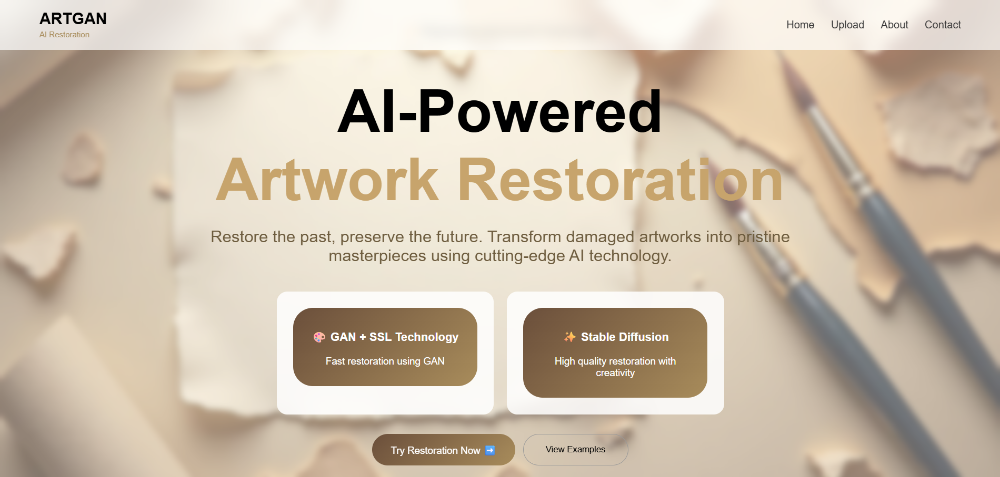
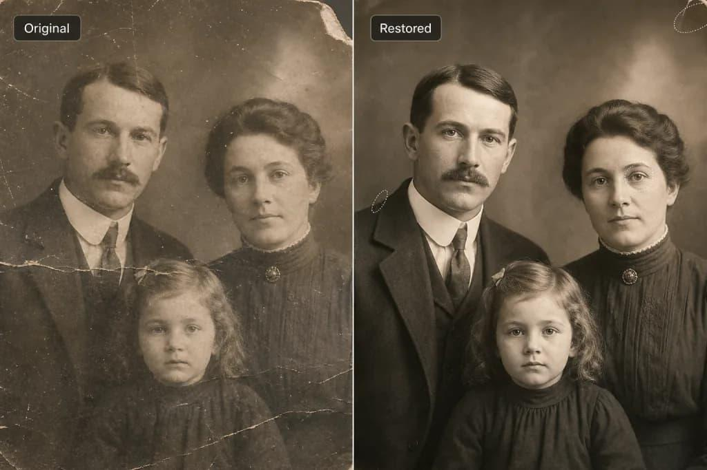

# ARTGAN – AI-Powered Artwork Restoration

ARTGAN is an AI-powered web application designed to restore damaged artwork and old photographs using deep learning and generative AI techniques.

The React application provides the user interface, while the AI models run in Google Colab because they require GPU resources.

## Project Preview

<p align="center">
  
</p>  

<p align="center">
  
</p>

<p align="center">
  <em>ARTGAN – AI-Powered Artwork and Old Photo Restoration</em>
</p>

## Features

ARTGAN includes two AI-powered restoration modes:

- **GAN-Based Restoration:** Uses Microsoft's [Bringing Old Photos Back to Life](https://github.com/microsoft/Bringing-Old-Photos-Back-to-Life) pretrained restoration approach. The Google Colab notebook serves the model through FastAPI and a temporary ngrok URL. Users can upload an image through the website and view the restored result.

- **Stable Diffusion Restoration:** Uses the `runwayml/stable-diffusion-inpainting` model through a Gradio application. Selecting this mode opens the Gradio interface inside the website, where users can upload images and perform AI-powered inpainting and restoration.

- **Image Upload:** Upload damaged photographs and artwork through an interactive web interface.

- **Image Preview:** Preview uploaded images before starting the restoration process.

- **Download Restored Images:** Download the resulting GAN-restored image from the website.

## Technology Stack

| Category | Technologies |
|---|---|
| Frontend | React.js, Vite |
| Backend | Python, FastAPI |
| Deep Learning | PyTorch |
| Restoration | GAN, Stable Diffusion |
| AI Interface | Gradio |
| GPU Environment | Google Colab |
| API Tunneling | ngrok |

## Requirements

Before running ARTGAN, make sure you have:

- [Node.js](https://nodejs.org/) version 18 or newer.
- A Google account that can run a Google Colab **GPU runtime** (T4 is sufficient).
- A free [ngrok](https://dashboard.ngrok.com/signup) account for the GAN API.
- A [Hugging Face](https://huggingface.co/) account for accessing Stable Diffusion model weights.

**Note:** The frontend can run locally on your computer. The AI restoration notebooks require a Colab GPU runtime to execute effectively.

## Repository Structure

```text
ARTGAN/
│
├── assets/
│   ├── Home.jpg
│   └── 1.jpg
│
├── frontend/
│   ├── src/
│   ├── public/
│   ├── package.json
│   └── ...
│
├── LatestGAN.ipynb
├── Stable_Diffusion.ipynb
│
├── ARTGAN IMAGES/
│   ├── 0001.jpg
│   ├── 2_damage.jpg.jpeg
│   ├── b.png
│   ├── c.png
│   ├── d.png
│   ├── crack5.png
│   ├── global.png
│   ├── HR.png
│   └── HR_result.jpeg
│
└── README.md
```

## Installation and Setup

### 1. Clone the Repository

```bash
git clone https://github.com/swarup1606/ARTGAN.git
```

Navigate into the project directory:

```bash
cd ARTGAN
```

### 2. Run the Frontend

Navigate to the frontend directory:

```bash
cd frontend
```

Create the environment file:

```bash
cp .env.example .env
```

For Windows PowerShell, use:

```powershell
Copy-Item .env.example .env
```

Install the dependencies:

```bash
npm install
```

Start the development server:

```bash
npm run dev
```

Open the local URL provided by Vite, usually:

```text
http://localhost:5173
```

Keep the environment variables empty until the Google Colab notebooks generate their public URLs.

After adding the URLs, restart the development server because Vite reads environment variables when it starts.

**Important:** The `.env` file is included in `.gitignore`. Do not upload it to GitHub.

## 3. Configure and Start GAN Restoration

The GAN restoration feature uses Microsoft's pretrained old photo restoration model.

Follow these steps:

1. Open [Google Colab](https://colab.research.google.com/).
2. Upload `LatestGAN.ipynb` from the repository.
3. Select **Runtime → Change runtime type → T4 GPU**.
4. In the final code cell, replace `YOUR_NGROK_AUTHTOKEN` with your ngrok authentication token from the [ngrok dashboard](https://dashboard.ngrok.com/get-started/your-authtoken).
5. Keep the token private and do not commit it to GitHub.
6. Execute the notebook cells from top to bottom, including the checkpoint checks and the two cells marked `FIX`.
7. These cells mount Google Drive, clone the Microsoft restoration repository into `MyDrive/OldPhotoRestoreProject`, install the dependencies, and download the required model files.
8. Skip the cell that calls `files.upload()` unless you want to test an individual image directly in Colab.
9. Run the cell that installs `pyngrok`, `fastapi`, and `uvicorn`.
10. Execute the final cell titled **Old Photo Restoration | FastAPI + ngrok Server**.

Keep the final cell running.

The notebook generates a public API URL similar to:

```text
https://something.ngrok-free.dev
```

Add this URL to `frontend/.env`:

```env
VITE_GAN_URL=https://something.ngrok-free.dev
```

Restart the frontend development server:

```bash
npm run dev
```

Now open the Upload page, select **GAN (Fast)**, upload an image, and click **Start Restoration**.

The first restoration may take approximately 30–60 seconds.

**Important:** The ngrok URL changes whenever you restart the Colab session. Update the environment variable accordingly. The API stops working when the notebook disconnects or the server cell stops.

## 4. Configure and Start Stable Diffusion

ARTGAN also includes a Stable Diffusion-based restoration interface using the `runwayml/stable-diffusion-inpainting` model.

Follow these steps:

1. Open a second Google Colab session.
2. Upload `Stable_Diffusion.ipynb`.
3. Select a GPU runtime.
4. Run the notebook cells in order.
5. The notebook installs the required pinned versions of `diffusers` and `transformers`.
6. The model is loaded and a Gradio application is launched.

If Hugging Face denies access to the model weights:

- Visit the [Stable Diffusion Inpainting model page](https://huggingface.co/runwayml/stable-diffusion-inpainting).
- Accept the model license if required.
- Generate a [Hugging Face access token](https://huggingface.co/settings/tokens).
- Authenticate from your Colab notebook.

Once the Gradio application starts, Colab generates a public URL similar to:

```text
https://something.gradio.live
```

Add the URL to `frontend/.env`:

```env
VITE_SD_GRADIO_URL=https://something.gradio.live
```

Restart the frontend:

```bash
npm run dev
```

Open the Upload page and select **Stable Diffusion (High Quality)**.

The Gradio application opens inside the website. Upload an image and use its Generate control to perform restoration.

**Important:** The Gradio share link is temporary and expires after approximately one week. It also stops working when the Colab session ends.

Free Colab GPU availability may limit running both restoration notebooks simultaneously. You may need to stop one session before starting the other.

## 5. Try the Application with Sample Images

The repository includes sample photographs and artwork in the `ARTGAN IMAGES` directory.

You can use these files to test the restoration features:

| Filename | Description |
|---|---|
| `0001.jpg` | Small sample photograph |
| `2_damage.jpg.jpeg` | Damaged photograph |
| `b.png` | Artwork sample |
| `c.png` | Artwork sample |
| `d.png` | Artwork sample |
| `crack5.png` | Cracked artwork |
| `global.png` | Larger sample image |
| `HR.png` | Higher-resolution input |
| `HR_result.jpeg` | Previous restoration result |

The website supports JPG, PNG, and WEBP formats, with a maximum upload size of 10 MB.

You can also upload your own photographs or artwork.

## 6. What to Expect

- **GAN Restoration:** Image restoration is requested through the website, and the restored result is displayed on the same page.
- **Stable Diffusion:** Image restoration and inpainting are performed through the embedded Gradio interface.
- **GPU Requirement:** Both restoration backends require a working Google Colab GPU runtime.
- **Backend Availability:** The respective Colab notebook and its public API or Gradio link must remain active while using the corresponding restoration feature.

## 7. Security

Keep your credentials and environment configuration secure.

- Never commit your ngrok authentication token.
- Never commit your Hugging Face access token.
- Never upload `frontend/.env` to GitHub.
- Keep authentication tokens inside private environment configurations or Colab secrets.
- If a token is accidentally exposed, revoke it immediately and generate a new one.

## Credits and References

This project integrates existing open-source AI models and tools.

- **GAN Restoration:** [Microsoft – Bringing Old Photos Back to Life](https://github.com/microsoft/Bringing-Old-Photos-Back-to-Life)
- **Stable Diffusion Inpainting:** [RunwayML – Stable Diffusion Inpainting](https://huggingface.co/runwayml/stable-diffusion-inpainting)
- **Frontend Framework:** [React](https://react.dev/)
- **Backend Framework:** [FastAPI](https://fastapi.tiangolo.com/)
- **AI Interface:** [Gradio](https://www.gradio.app/)
- **GPU Environment:** [Google Colab](https://colab.research.google.com/)

---

<p align="center">
  <b>ARTGAN – Restore the Past, Preserve the Future.</b>
</p>

<p align="center">
  Developed with ❤️ using Artificial Intelligence and Deep Learning.
</p>
